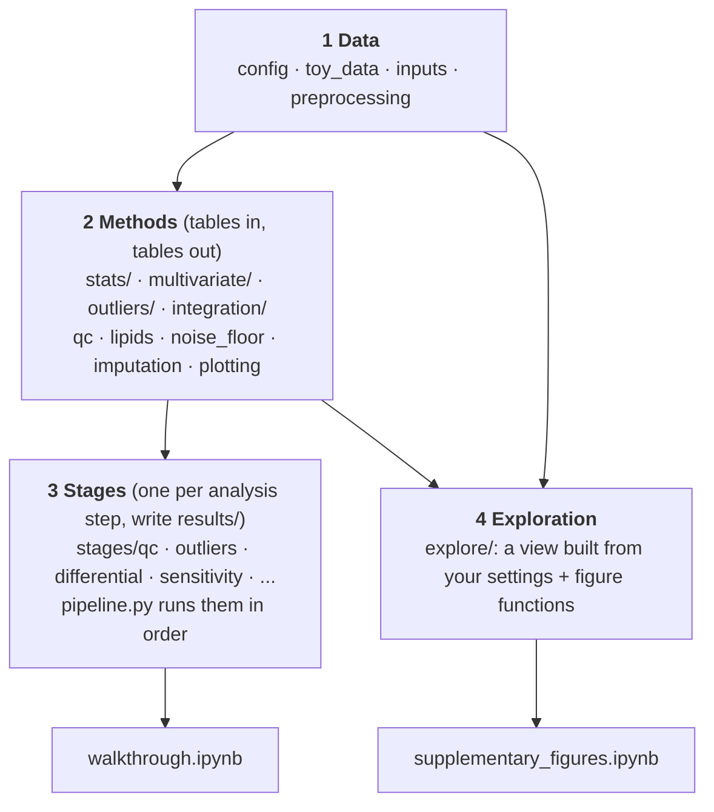

# MIA multi-omics integration pipeline

Does **maternal immune activation (MIA)** during pregnancy change the brains of
the offspring? This repository holds the analysis pipeline for a mouse study
with **20 offspring** (10 MIA, 10 saline control). Each mouse gives **3 brain
regions** (cortex, cerebellum, hippocampus), and every one of the 60 samples was
measured with **lipidomics, metabolomics and proteomics**.

The pipeline goes from the core facility's raw files to quality control,
outlier screening, per-feature models, multivariate analysis and multi-omics
integration (MOFA+). It is a cleaned-up, refactored copy of the analysis code
of an MSc thesis, prepared for a scientific-programming course.

> **The data in this repository are simulated.** The real study data cannot be
> shared. `mia_multiomics.toy_data` writes files with exactly the same layout as
> the real deliverables, with a known truth planted in them (see
> [The toy data](#the-toy-data)). Because the truth is known, you can check
> whether each method finds what is there and nothing else.

---

## Start here: the two notebooks

Both notebooks are in `notebooks/` and **have already been run**, so all tables
and figures are visible as soon as you open them. You only need to run them if
you want to change something.

| Order | Notebook | What it is | Run time |
|---|---|---|---|
| **1** | [`notebooks/walkthrough.ipynb`](notebooks/walkthrough.ipynb) | **The main notebook.** A guided run of the whole pipeline, from raw files to multi-omics integration, with an explanation of every step and the results on the toy data. Start here. | ~15 min |
| **2** | [`notebooks/supplementary_figures.ipynb`](notebooks/supplementary_figures.ipynb) | **The exploration notebook.** The figures of the original thesis repository that the walkthrough does not show (73 figures), recomputed from a settings cell: remove any samples, change the filtering thresholds, normalisation, scaling or FDR level, or switch omics layer. | ~1 min |

### 1. `walkthrough.ipynb`: the story of the analysis

Each section runs one pipeline stage and shows its key table or figure.

| Section | Question |
|---|---|
| 1 The input files | What did the core facility deliver, and how is it read? |
| 2 Preprocessing | Which features and values are removed, and why? |
| 3 Quality control | Is the pooled QC reproducible? What structure do the data have? |
| 4 Outliers | Which samples are unusual (Hotelling T², calibrated 6-detector ensemble)? |
| 5 MIA vs control, feature by feature | Group x sex model per region: are there any hits, and do they survive outlier removal? |
| 6 Does the answer depend on analysis choices? | Specification curve, imputation, normalisation, litter-aware models |
| 7 Do regional differences persist after MIA? | Is each region's profile the same in MIA and control mice? |
| 8 ASCA+ | One multivariate ANOVA, with permutation tests at the right unit (mouse, litter) |
| 9 Effect sizes | How large could an MIA effect be? Lipid composites, protein sets |
| 10 Multi-omics integration | MOFA+, within-region MOFA+, benchmark, cross-omics modules, enrichment |
| 11 The facility's report figures | Why a PLS-DA score plot separates groups even on noise |
| 12 The whole pipeline in one call | `pipeline.run_all` and the command line |

### 2. `supplementary_figures.ipynb`: explore with your own settings

Edit the first code cell, then choose *Kernel → Restart & Run All*:

```python
OMICS = "lipidomics"            # or "metabolomics", "proteomics"
EXCLUDE = [10, 45]              # remove any samples (numbers or IDs); [] = all 60
MAX_MISSING_FRACTION = 0.20     # prevalence filter (None = off)
BLANK_MULTIPLIER = 3.0          # blank filter and detection limit
NORMALIZATION = "median"        # or "pqn"
SCALING = "autoscaled"          # or "pareto", "unscaled"
FDR_ALPHA = 0.05
REGION = "Cortex"               # region of the single-region figures
EFFECT = "MIA vs Saline Control"
SAVE_FIGURES = False            # True: write every figure as PNG to results/supplementary/<run name>/
```

The defaults reproduce the primary analysis (all 60 samples, current
filtering). The notebook lists the samples flagged by the Hotelling T² screen
and warns if a whole mouse is removed. Every figure prints, in grey underneath,
the settings it was drawn with. Its 15 sections cover preprocessing and pooled
QC, missingness, the noise floor, PCA scores and loadings, the outlier screen
and ensemble, per-feature models, co-abundance modules, litters, regional
profiles, ASCA+, the facility-style figures and the lipid-protein myelin check.

> The `.ipynb` files are generated by `notebooks/build_notebook.py` and
> `notebooks/build_supplementary.py`, which keep the notebook text and code
> under version control in readable form. Edit the builder, then run it to
> regenerate the notebook.

---

## Setup

Python 3.10 or newer.

```bash
python -m venv .venv
source .venv/bin/activate              # Windows: .venv\Scripts\activate
pip install -r requirements.txt
pip install -e .                       # makes `import mia_multiomics` work from anywhere

jupyter lab                            # then open notebooks/walkthrough.ipynb
```

(With `uv`: `uv venv && uv pip install -r requirements.txt && uv pip install -e .`)

Without the notebooks:

```bash
python -m mia_multiomics.toy_data                   # (re)write the simulated data into data/
python -m mia_multiomics.pipeline --fast            # every step, small resampling counts (~20 min)
python -m mia_multiomics.pipeline --fast --only qc outliers differential
python -m mia_multiomics.pipeline                   # full-size run (slow)
pytest                                              # 185 tests, ~4 min
```

---

## How the repository is organised

```
multi-omics-integration-pipeline/
├── README.md                  this file
├── notebooks/                 START HERE: the two notebooks and the scripts that generate them
│   ├── walkthrough.ipynb          1. the guided run of the whole pipeline
│   ├── supplementary_figures.ipynb 2. every other figure, with adjustable settings
│   ├── build_notebook.py          generates walkthrough.ipynb
│   └── build_supplementary.py     generates supplementary_figures.ipynb
├── src/mia_multiomics/        the Python package (all analysis code; see below)
├── data/                      the simulated input files (+ data/README.md: file formats)
│   └── reference/                 toy GO / Reactome gene-set files (GMT) for enrichment
├── results/                   created when you run anything: every table and figure (git-ignored)
├── tests/                     pytest suite: library functions + end-to-end runs on the toy data
├── r/                         optional R cross-checks (limma, noisyR, DIABLO, MFA, ASCA); see r/README.md
├── docs/refactoring_notes.md  how the code maps to the original thesis repository, bugs found
├── pyproject.toml             package definition (pip install -e .)
└── requirements.txt           dependencies
```

### The package: four layers

The code in `src/mia_multiomics/` is organised in layers. Each layer uses only
the layers above it, so a method can be read, tested and reused without the
rest of the pipeline.



**Layer 1: data.** Reading the delivered files and turning them into
normalised log2 abundances.

| File | What it does |
|---|---|
| `config.py` | Every fixed choice in one place: file names, thresholds, the three permitted analysis populations, and `Settings` (run sizes: `Settings.fast` for the notebook, `Settings.full` for the thesis-size run) |
| `toy_data.py` | Simulator that writes the toy dataset in the real file layout, with the planted truth |
| `inputs.py` | Readers for the facility's Excel report, the cage workbook and the Perseus proteomics exports; returns one `OmicsData` (values, blanks, pooled QC, feature annotation, sample metadata) per omics |
| `preprocessing.py` | `preprocess()`: prevalence filter, blank filter, detection limit, log2, median or PQN normalisation. No imputation; every removed feature is logged with its reason |
| `imputation.py` | Label-free imputers, used only in sensitivity analyses |

**Layer 2: methods.** Statistical and multivariate building blocks. They take
tables and return tables, and know nothing about file locations (the only
exceptions are the optional R and internet adapters, `noisyr.py` and
`lipid_databases.py`).

| Folder / file | Contents |
|---|---|
| `stats/` | `differential.py` (OLS group x sex model per region), `permutation.py` (permutation null, effective number of tests), `clustered.py` (cage/litter statistics), `power.py` (detectable effect sizes), `region_contrast.py` (paired regional contrasts, split-half disattenuation), `asca_permutation.py` (permutation schemes for ASCA+), `permanova.py`, `diagnostics.py` (p-value calibration, residuals), `common.py` (BH-FDR, R², empirical p) |
| `multivariate/` | `pca.py` (PCA, loadings, Hotelling ellipses, design attribution), `asca.py` (ASCA+ decomposition), `plsda.py` (PLS-DA and its permutation test), `feature_modules.py` (feature-space PCA, co-abundance modules), `vendor.py` (the facility's heatmap ordering) |
| `outliers/` | `screen.py` (Hotelling T², robust Mahalanobis, DModX), `detectors.py` (kNN, LOF, isolation forest, kernel PCA, Ledoit-Wolf), `calibration.py` (calibration against simulated outlier-free data), `ensemble.py` (stability and corroboration rules) |
| `integration/` | `mofa.py` (MOFA+ fitting and seed stability), `inference.py` (litter-aware tests of integration scores), `enrichment.py` (GMT parsing, hypergeometric enrichment), `common.py` |
| `qc.py` | Pooled-QC CV, technical vs biological variance, missingness summaries, cross-assay outlier concordance |
| `lipids.py` | Lipid-name parsing, class and structural (chain length, unsaturation) summaries |
| `noise_floor.py`, `noisyr.py` | Abundance-similarity curves (noisyR-style) and the adapter for the optional R noisyR check |
| `lipid_databases.py` | Optional LIPID MAPS / KEGG annotation (needs internet) |
| `plotting.py` | Shared colours, style and plot types, so all figures look the same |

**Layer 3: stages.** One module per analysis step. Each has a
`run(settings, ...)` function that loads and preprocesses the data, calls the
methods, and writes its tables and figures under `results/`. The walkthrough
notebook calls these, and `pipeline.py` runs all of them in order.

| Stage | Module | Output folder | What it answers |
|---|---|---|---|
| QC | `stages/qc.py` | `results/<omics>/01_qc/` | What did preprocessing remove? Is the pooled QC reproducible? What structure is there? |
| noise floor | `stages/noise_floor.py` | `.../01_qc/noise_floor/` | Below which abundance are lipids noise? |
| feature modules | `stages/feature_modules.py` | `.../01_qc/feature_modules/` | Do features form co-abundance modules beyond chance? |
| outlier screen | `stages/outliers.py: run_screen` | `.../02_outliers/` | Hotelling T², robust Mahalanobis, DModX; defines `t2_95` and `t2_99` |
| outlier ensemble | `stages/outliers.py: run_ensemble` | `.../02_outliers/ensemble/` | Do several calibrated detectors agree on a sample? |
| differential | `stages/differential.py` | `.../03_differential/<population>/` | Group x sex model per region, FDR, permutation null, effective tests, detectable effects |
| sensitivity | `stages/sensitivity.py` | `.../04_sensitivity/` | Does the answer change with filtering, imputation, normalisation or litter-aware models? |
| region persistence | `stages/region_persistence.py` | `.../05_region_persistence/` | Is the control region-difference profile preserved in MIA? |
| ASCA+ | `stages/asca.py` | `.../06_asca/` | Variance share of region, MIA and sex, with permutation tests at the right unit |
| effect sizes | `stages/effect_sizes.py` | `results/integration/07_effect_sizes/` | How large could an MIA effect be? Lipid composites, protein sets |
| integration | `stages/integration.py` | `results/integration/` | MOFA+, within-region MOFA+, benchmark, cross-omics modules, enrichment, covariate map, litter-level inference |
| facility figures | `stages/vendor_figures.py` | `results/lipidomics/09_vendor_figures/` | The facility's heatmaps and PLS-DA plots, plus the permutation test they lacked |

`stages/common.py` holds what the stages share (cached loading, `prepare()` =
load + preprocess for one population, CSV/JSON writers), and `pipeline.py` is
the command-line entry point (`python -m mia_multiomics.pipeline`).

**Layer 4: exploration.** `explore/` powers the supplementary notebook.
`explore/view.py` builds a `View` (the preprocessed data of one omics plus all
of your choices), and each figure module draws from a view and returns a
Matplotlib figure:

| File | Figures |
|---|---|
| `explore/view.py` | `Options` (every adjustable choice), `View`, `build_view()` |
| `explore/qc_figures.py` | feature funnel, prevalence curve, signal-to-blank, Tech-Mix CV and drift, missingness, noise floor |
| `explore/pca_figures.py` | scree variants, score plots, pooled composite, Hotelling ellipses, six loading views |
| `explore/outlier_figures.py` | T², DModX, influence plot, suggested exclusions, assay concordance, ensemble diagnostics |
| `explore/differential_figures.py` | volcanoes, p-value histograms, small-p counts, top hits, forest plot, single-feature profile, lipid classes |
| `explore/structure_figures.py` | co-abundance modules, litter plots, regional differences, ASCA+, facility-style heatmap and PLS-DA, lipid vs protein myelin |

They can be used without the notebook:

```python
from mia_multiomics import explore
from mia_multiomics.config import Settings

view = explore.build_view(Settings.fast("."), explore.Options(exclude=[10, 45], normalization="pqn"))
explore.volcano(view, region="Cortex", effect="Female vs Male")
```

### Where the results go

Nothing is stored in the repository; running the notebooks or the pipeline
creates `results/`:

```
results/
├── lipidomics/  metabolomics/  proteomics/   (proteomics: 01_qc only)
│   ├── 01_qc/                 preprocessing log, pooled QC, missingness, PCA, noise floor, feature modules
│   ├── 02_outliers/           outlier_screen.csv (defines t2_95 / t2_99), ensemble/
│   ├── 03_differential/       one folder per population (all60, t2_95, t2_99) and sensitivity variant
│   ├── 04_sensitivity/        specification curve, RF / PQN variants, cage (litter) structure
│   ├── 05_region_persistence/ per population
│   ├── 06_asca/               per population
│   └── 09_vendor_figures/     (lipidomics only)
├── integration/               00_inputs ... 09_inference_checks (MOFA+, benchmark, enrichment, effect sizes)
├── cross_omics/               do lipidomics and metabolomics flag the same outliers?
└── supplementary/             figures saved by the supplementary notebook (SAVE_FIGURES = True)
```

Every folder holds the tables as CSV and a `figures/` subfolder with PNGs.

---

## The toy data

| Planted in the toy data | What the pipeline should find |
|---|---|
| strong brain-region differences in all omics | region dominates every analysis (positive control) |
| **no MIA effect at all** | no robust MIA hit (negative control) |
| litter (cage) and mouse random effects | mouse-level tests are too optimistic; litter-level tests are honest |
| a small sex effect on ceramides | hits that appear only after removing outlier samples (standard-error shrinkage) |
| two shared within-region programmes ("myelin", "energy") and sex-linked proteins | MOFA+ factors shared across omics; enrichment names the myelin module |
| two outlying samples (sample numbers 10 and 45) | flagged by the outlier screens |

The design mirrors the real study: 8 litters (cages), 2 mixed-sex control litters
and 6 single-sex MIA litters, collected on three dates. See
`data/TOY_DATA_README.txt` and `data/README.md`.

## Analysis rules built into the code

* **Populations.** The pipeline uses only three: all 60 samples (`all60`, the
  primary analysis), or a sample-level removal of the samples flagged by the
  regional Hotelling T² screen at 95 % or 99 % (`t2_95`, `t2_99`). A whole mouse
  is never removed. These are listed in `config.POPULATIONS`. (The
  supplementary notebook lets you remove any sample, to see what each choice
  does.)
* **No silent imputation.** Missing and below-detection values stay missing.
  Imputation appears only in sensitivity analyses, and only label-free.
* **The litter is the experimental unit for MIA.** Pups share a mother, cage
  and collection date. Tests are therefore also run with whole-litter
  permutations, whose smallest possible p-value (1/28 here) is reported.
* **Calibrate against a null.** Outlier detectors, integration factors and
  significance counts are always compared with simulated or permuted null data.

## Tests

`pytest` runs 185 tests in about 4 minutes. `tests/conftest.py` writes a fresh
toy dataset into a temporary folder, so the tests never touch `data/` or
`results/`. Most test files check one library module (for example
`test_preprocessing.py`, `test_asca.py`, `test_outlier_detectors.py`);
`test_stages_smoke.py` runs the cheap stages end to end and checks that they
find the planted truth; `test_explore.py` draws every supplementary figure.

## Running on the real data

Put the real files in `data/` and point the file names in `config.py`
(`REPORT_WORKBOOK`, `CAGE_WORKBOOK`, `PROTEOMICS_FILES`, `REFERENCE_DIR`) and
`SAMPLE_PREFIX` at them. `data/README.md` describes the expected layout. Then
run `python -m mia_multiomics.pipeline` (full size), or the notebooks with
`Settings.full`. `.gitignore` keeps files whose name contains `real` out of
version control.

## Optional R steps

The Python pipeline is complete on its own. `r/` holds the R cross-checks used
in the thesis: limma, noisyR, mixOmics DIABLO, FactoMineR MFA and a base-R ASCA.
Enable the first two with `--with-r` or `settings.with_(use_r=True)`. The others
are run by hand after the pipeline. See `r/README.md`.

## Relation to the thesis repository

`docs/refactoring_notes.md` explains what changed compared with the original
code: about 60 runner scripts became 11 stage modules on one shared data
layer, duplicated statistics became single tested functions, and every figure
type of the original is mapped to a stage or an `explore` function. It also
lists the bugs found during the refactoring.
